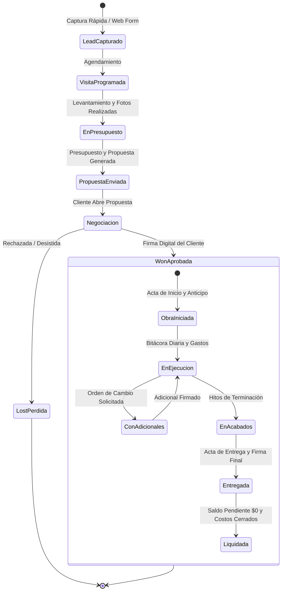

# PRD --- ObraFlow

## Plataforma SaaS Integral de Ventas, Presupuestos y Gestión de Obra para Contratistas Generales y Empresas de Remodelación

**Versión:** 2.0  
**Estado:** Aprobado para Desarrollo y Especificación Técnica  
**Tipo de producto:** SaaS B2B Web Responsive / PWA Mobile-First (Offline-Ready)  
**Mercado inicial:** Colombia y LATAM (Esquema tributario IVA y AIU)  
**Modelo de negocio:** Suscripción mensual / anual por Organización (Multi-Tenant)  
**Usuarios objetivo:** Dueños de empresas de remodelación, contratistas generales, residentes de obra y clientes finales  
**Alcance central:** CRM pre-venta + Visitas técnicas + Presupuestador paramétrico (IVA/AIU) + Propuesta digital con firma + Control de costos en campo (Job Costing) + Órdenes de cambio + Bitácora fotográfica diaria + Portal de cliente  

---

## 1. Resumen ejecutivo

**ObraFlow** es una plataforma SaaS multi-tenant diseñada específicamente para contratistas generales y empresas especializadas en remodelaciones integrales, acabados y obra liviana/mediana (residencial y comercial). 

La plataforma conecta todo el ciclo de vida del negocio: desde la captura inmediata del prospecto en campo y el levantamiento de la visita técnica, hasta la presupuestación por capítulos y partidas (bajo régimen general de IVA o esquema AIU), el envío y firma digital de propuestas comerciales interactivas, la supervisión diaria en obra (bitácora fotográfica, control de compras con fotos de facturas, órdenes de cambio adicionales aprobadas por el cliente) y el control financiero estricto de rentabilidad (Presupuesto vs. Costo Real).

ObraFlow erradica la fuga silenciosa de margen provocada por cambios no cobrados en obra, la pérdida de recibos físicos, la desinformación del cliente y el descontrol entre lo cotizado en oficina y lo gastado en campo.

### Problemas críticos que resuelve

1. **Leads perdidos por falta de captura ágil:** Los contratistas pierden clientes potenciales mientras están en obra o conduciendo por no contar con una herramienta para registrar un lead en menos de 15 segundos.
2. **Presupuestación lenta y propensa a errores:** Cotizaciones elaboradas en hojas de cálculo desarticuladas, sin catálogo maestro unificado y con dificultades para estructurar impuestos de construcción (AIU vs. IVA tradicional).
3. **Pérdida de margen por "adicionales" no documentados:** Cambios verbales solicitados por el cliente en obra que la cuadrilla ejecuta sin orden de cambio formal firmada, resultando en sobrecostos no cobrados y fricciones al liquidar.
4. **Fuga de costos en campo y extravío de recibos:** Gastos de caja menor, compras de materiales de urgencia y jornales registrados en libretas de papel o chats de WhatsApp sin imputación a capítulos del presupuesto.
5. **Ansiedad y desconfianza del cliente final:** Llamadas continuas para pedir reportes de avance y falta de transparencia sobre el estado de cuenta y los pagos realizados.
6. **Desconexión entre oficina y obra remota:** Supervisores sin acceso a especificaciones actualizadas por falta de conectividad en sótanos o zonas de baja señal.

---

## 2. Visión y propuesta de valor

Convertirse en el sistema operativo estándar para los contratistas de remodelación y obra civil liviana en Colombia y Latinoamérica, profesionalizando su gestión comercial, protegiendo su margen de utilidad y elevando la experiencia del cliente final.

**Propuesta de valor:** 
- **Para el Contratista / Dueño:** Control total del flujo de caja y rentabilidad en tiempo real (Job Costing), blindaje legal mediante firma digital de contratos y órdenes de cambio, y cotizaciones profesionales en minutos.
- **Para el Residente / Supervisor de Obra:** Herramienta de campo ultra-ligera y táctil (PWA offline) para registrar bitácoras fotográficas y recibos de compra con un solo clic, sin formularios engorrosos ni acceso a cifras confidenciales.
- **Para el Cliente Final:** Un portal transparente (sin contraseñas) accesible vía enlace seguro para ver el progreso real de su proyecto, aprobar cambios y tener claridad de sus saldos.

---

## 3. Objetivos del producto e indicadores de éxito

| Objetivo Estratégico | Indicador de Éxito (KPI) | Meta Objetivo MVP |
| :--- | :--- | :--- |
| **Acelerar la captura comercial** | Tiempo de registro de un nuevo lead en campo | $\le 15$ segundos desde móvil |
| **Reducir tiempo de presupuestación** | Tiempo promedio de elaboración de propuesta | Reducción del 60% vs. hojas de cálculo |
| **Blindar cobro de adicionales** | Porcentaje de órdenes de cambio formalizadas y firmadas | $\ge 95\%$ de adicionales ejecutados con firma digital |
| **Trazabilidad de gastos en obra** | Porcentaje de gastos de obra con soporte fotográfico | 100% de gastos imputados con foto de factura/recibo |
| **Cero fricción en campo** | Tiempo de carga y sincronización de bitácora diaria | Subida de fotos optimizadas en $<2$ seg por imagen |
| **Reducir reclamos de clientes** | Satisfacción de clientes al cierre de obra | NPS $> 75$ mediante portal interactivo de seguimiento |

---

## 4. Usuarios y matriz de perfiles de acceso (RBAC)

El sistema opera bajo un esquema simplificado y estricto de control de accesos, garantizando que el personal de campo opere con ergonomía táctil y sin comprometer información financiera sensible.

| Perfil / Rol | Tipo de Acceso | Responsabilidades y Permisos Clave |
| :--- | :--- | :--- |
| **Dueño / Contratista General (`owner`)** | Web Desktop & PWA Mobile (Autenticado con JWT) | **Acceso Total:** Configuración de empresa, catálogo maestro de costos unitarios, márgenes de utilidad, creación y envío de presupuestos, aprobación de gastos, estados de cuenta, reportes de rentabilidad y métricas. |
| **Residente de Obra / Maestro (`resident`)** | PWA Mobile-First (Autenticado con JWT) | **Acceso Operativo de Campo:** Visualización de alcance técnico y cantidades a ejecutar (costos unitarios y márgenes enmascarados/ocultos). Registro de bitácora diaria (fotos y notas), registro de compras/gastos con foto de recibo, reporte de solicitudes de órdenes de cambio (borrador) y actualización de hitos. Soporte Offline. |
| **Cliente Final (`client`)** | Portal Web Público (Magic Link UUIDv4 seguro) | **Sin Login ni Contraseña:** Consulta y firma digital de la propuesta comercial, visualización de bitácora fotográfica pública (solo entradas marcadas como visibles), consulta de estado de cuenta (anticipos, saldos, hitos) y aprobación/firma de órdenes de cambio. |

---

## 5. Alcance funcional del producto

### 5.1 Módulos incluidos en el MVP (P0 / P1)

1. **Módulo 0: CRM Comercial y Pre-Venta**
   - Captura rápida de prospectos en campo ($\le 15$ segundos con 4 campos obligatorios).
   - Formulario público embebible/iframe para captar leads desde redes sociales o sitio web con compresión de fotos.
   - Embudo Kanban de pre-venta (*Nuevo Lead*, *Visita Agendada*, *En Presupuesto*, *Propuesta Enviada*, *Negociación*, *Ganado*, *Perdido*).
2. **Módulo 1: Visita Técnica y Levantamiento Inicial**
   - Agendamiento de visita técnica con recordatorio.
   - Captura de notas técnicas en sitio y galería fotográfica de "Estado Actual / Antes".
3. **Módulo 2: Catálogo de Costos y Constructor de Presupuestos**
   - Catálogo maestro de insumos y actividades (Materiales, Mano de obra, Equipos, Subcontratos).
   - Estructuración jerárquica por Capítulos y Partidas con unidades de medida (`m2`, `ml`, `und`, `glb`, etc.).
   - Motor tributario dual: Régimen de IVA general o Esquema AIU (Administración, Imprevistos, Utilidad con IVA aplicado a la utilidad).
   - Diferenciación estricta entre Costo Directo Interno y Precio de Venta al Cliente.
4. **Módulo 3: Propuestas Comerciales, Tracking y Firma Digital**
   - Generación automática de propuesta interactiva responsive con marca del contratista.
   - Enlace único (Magic Link UUID) para visualización en el teléfono del cliente.
   - Tracking de apertura y lectura de propuesta por el cliente.
   - Módulo de firma electrónica digital (Canvas HTML5 táctil) con captura de trazo y hash criptográfico de integridad.
   - Exportación de propuesta en PDF formal de alta fidelidad.
5. **Módulo 4: Control de Costos en Obra (Job Costing) y Órdenes de Cambio**
   - Conversión automática de presupuesto aprobado en Proyecto de Obra activo.
   - Registro de gastos de campo (compras de materiales, pagos de jornales, fletes) con foto obligatoria de recibo/factura e imputación a partida.
   - Comparativo dinámico: Costo Presupuestado vs. Costo Real vs. Precio Facturado.
   - Gestión de Órdenes de Cambio (Adicionales solicitados por cliente o imprevistos técnicos): cálculo de sobrecosto, envío al portal del cliente y firma previa a la ejecución.
6. **Módulo 5: Cronograma Ligero y Bitácora Diaria de Obra (Daily Logs)**
   - Cronograma por hitos macro y tareas principales asociadas a capítulos.
   - Bitácora diaria de obra: registro rápido con clima, personal activo, fotos de avance y observaciones técnicas.
   - Flag de visibilidad para el cliente (`visible_to_client: true/false`).
   - Modo PWA con tolerancia offline (IndexedDB) para subida diferida cuando no hay señal.
7. **Módulo 6: Portal del Cliente y Control de Cobros**
   - Dashboard público para el cliente con Magic Link.
   - Registro y control de anticipos, cobros por hito y saldo pendiente.
   - Visualización de la galería fotográfica de avance.
8. **Módulo 7: Dashboard Ejecutivo y Métricas**
   - Indicadores de pipeline comercial, obras activas, variación presupuestal global y margen proyectado vs. real.

### 5.2 Fuera del MVP inicial (Fases Futuras)

- Integración contable directa con ERPs pesados (SAP, Siigo, Oracle).
- Facturación electrónica fiscal directa ante DIAN (en el MVP se gestionan cuentas de cobro y registro de facturas emitidas externamente).
- Importador nativo de archivos Microsoft Project o Primavera P6 (se utiliza cronograma ligero nativo).
- Lectura y modelado BIM 3D (Revit/IFC) o visualizador CAD en línea.
- Conexión con sensores IoT de clima o básculas de camiones de escombros.
- Chat interno en tiempo real (se apoya en notificaciones y enlaces directos a WhatsApp).

---

## 6. Requerimientos funcionales detallados

### RF-01. Autenticación y Multi-Tenancy

| ID | Requerimiento | Prioridad | Criterio de Aceptación |
| :--- | :--- | :---: | :--- |
| **RF-001** | Registro de Organización (Tenant) | P0 | Permite a una empresa contratista crear su cuenta, definir nombre comercial, NIT/RFC, moneda y esquema impositivo predeterminado (IVA o AIU). |
| **RF-002** | Autenticación Segura (JWT) | P0 | Login con email y contraseña encriptada (Argon2id/bcrypt). Sesiones con expiración e inyección de contexto tenant en PostgreSQL RLS. |
| **RF-003** | Gestión de Usuarios y Roles | P0 | El dueño puede invitar usuarios y asignar rol estricto: `owner` o `resident`. |
| **RF-004** | Aislamiento de Datos por Organización | P0 | Ningún usuario de una organización puede consultar, alterar ni adivinar identificadores de otra organización (RLS estricto). |

### RF-02. CRM y Embudo Comercial de Remodelaciones

| ID | Requerimiento | Prioridad | Criterio de Aceptación |
| :--- | :--- | :---: | :--- |
| **RF-005** | Captura Rápida de Lead en Campo | P0 | Formulario bottom-sheet en móvil accesible en $<15$ seg con solo 4 campos: Nombre, Teléfono/WhatsApp, Dirección del Inmueble y Tipo de Obra. |
| **RF-006** | Formulario Web Público Embebible | P1 | Enlace público e iframe con logo de la empresa para captar solicitudes en redes sociales, permitiendo carga y compresión de fotos del espacio actual. |
| **RF-007** | Pipeline Kanban de Ventas | P0 | Tablero de tarjetas con etapas: *Nuevo Lead*, *Visita Agendada*, *En Presupuesto*, *Propuesta Enviada*, *Negociación*, *Ganada*, *Perdida*. Drag-and-drop y filtrado. |
| **RF-008** | Registro de Motivo de Pérdida | P1 | Al mover a "Perdido", exige seleccionar causa (*Precio*, *Tiempo*, *Eligió otro contratista*, *Sin respuesta*). |

### RF-03. Visitas Técnicas y Levantamiento de Campo

| ID | Requerimiento | Prioridad | Criterio de Aceptación |
| :--- | :--- | :---: | :--- |
| **RF-009** | Programación de Visita Técnica | P0 | Asignación de fecha, hora y notas técnicas de acceso para la visita de inspección. |
| **RF-010** | Galería Fotográfica del Antes | P0 | Carga directa de fotos desde la cámara del celular con compresión en el cliente ($<800$ KB) y categorización por área (Baño, Cocina, Fachada, General). |

### RF-04. Catálogo Maestro y Motor de Presupuestos (IVA / AIU)

| ID | Requerimiento | Prioridad | Criterio de Aceptación |
| :--- | :--- | :---: | :--- |
| **RF-011** | Catálogo Maestro de Costos | P0 | Base de datos de partidas reutilizables categorizadas en *Material*, *Mano de Obra*, *Equipo/Herramienta* y *Subcontrato*, con unidad de medida y costo unitario interno base. |
| **RF-012** | Estructuración por Capítulos y Partidas | P0 | Creación de presupuestos organizados en capítulos (ej. *01. Demoliciones*, *02. Mampostería*, *03. Instalaciones Hidráulicas*, *04. Acabados*) y partidas detalladas. |
| **RF-013** | Motor de Precios y Margen de Utilidad | P0 | Cálculo automático del precio de venta por partida a partir del costo unitario interno y el porcentaje de margen configurado, o margen global de propuesta. |
| **RF-014** | Esquema Tributario AIU (LATAM/Colombia) | P0 | Soporte para estructurar presupuestos bajo esquema AIU: desglose de Costo Directo + % Administración + % Imprevistos + % Utilidad, liquidando el IVA exclusivamente sobre la Utilidad. |
| **RF-015** | Control de Versiones de Presupuesto | P0 | Generación de versiones (v1, v2, v3). Al aprobar una versión, se congelan los precios y cantidades para evitar modificaciones inadvertidas. |

### RF-05. Propuestas Digitales y Firma Electrónica

| ID | Requerimiento | Prioridad | Criterio de Aceptación |
| :--- | :--- | :---: | :--- |
| **RF-016** | Generación de Propuesta Digital Interactiva | P0 | Vista web responsiva con portada personalizada, descripción del alcance, desglose por capítulos, condiciones de pago y exclusiones. |
| **RF-017** | Magic Link Seguro para el Cliente | P0 | Acceso público sin usuario ni contraseña mediante URL ofuscada con token UUIDv4 efímero o renovable. |
| **RF-018** | Firma Electrónica en Pantalla (Canvas) | P0 | El cliente puede firmar directamente con el dedo o puntero en su pantalla táctil, registrando firma PNG, fecha, hora, dirección IP y User-Agent. |
| **RF-019** | Generación y Descarga de PDF Formal | P0 | Renderizado determinista de la propuesta contractual firmada en PDF para archivo legal de ambas partes. |

### RF-06. Ejecución de Obra, Control de Costos (Job Costing) y Órdenes de Cambio

| ID | Requerimiento | Prioridad | Criterio de Aceptación |
| :--- | :--- | :---: | :--- |
| **RF-020** | Conversión de Propuesta Ganada a Obra | P0 | Una propuesta aprobada y firmada crea automáticamente el proyecto de obra con sus capítulos y presupuesto meta asignado. |
| **RF-021** | Registro de Gastos de Obra en Campo | P0 | El residente registra compras menores, materiales o jornales con fecha, monto, concepto, partida asociada y captura obligatoria de la foto del recibo. |
| **RF-022** | Enmascaramiento de Costos para Residente | P0 | La interfaz móvil del residente oculta márgenes de ganancia, costos unitarios internos y precios de venta al cliente; solo muestra cantidades y alcance técnico. |
| **RF-023** | Auditoría y Aprobación de Gastos | P0 | El dueño puede aprobar, rechazar o reclasificar los gastos registrados en campo por el residente. |
| **RF-024** | Gestión de Órdenes de Cambio (Adicionales) | P0 | Creación de adicionales con descripción, costo, precio al cliente y justificación. Envío de notificación y solicitud de firma digital al cliente antes de ejecutar el trabajo. |
| **RF-025** | Reporte Comparativo Presupuesto vs. Real | P0 | Matriz en tiempo real que compara: Costo Estimado Inicial vs. Adicionales Aprobados vs. Costo Real Ejecutado vs. Desviación porcentual por capítulo. |

### RF-07. Cronograma Ligero y Bitácora Diaria (PWA Offline)

| ID | Requerimiento | Prioridad | Criterio de Aceptación |
| :--- | :--- | :---: | :--- |
| **RF-026** | Cronograma de Hitos Principales | P1 | Definición de fechas clave de entrega y fases principales con indicador de estado (*Pendiente*, *En Progreso*, *Completado*, *Atrasado*). |
| **RF-027** | Bitácora Diaria de Obra (Daily Log) | P0 | Creación de entradas diarias con registro de condiciones climáticas (Soleado, Lluvia), personal activo en obra, avances logrados y novedades. |
| **RF-028** | Registro Fotográfico con Marcador de Visibilidad | P0 | Carga de fotos de avance diario desde el móvil con selector de visibilidad hacia el portal del cliente (`Público para cliente` vs. `Uso interno de obra`). |
| **RF-029** | Operatividad Offline en Campo | P0 | Si el residente no tiene conexión a internet en la obra, la PWA almacena notas y fotos en IndexedDB local y sincroniza automáticamente al recuperar conectividad. |

### RF-08. Portal del Cliente y Gestión de Cartera

| ID | Requerimiento | Prioridad | Criterio de Aceptación |
| :--- | :--- | :---: | :--- |
| **RF-030** | Portal de Seguimiento del Cliente | P0 | Interfaz web móvil sin login donde el cliente consulta el avance general de su remodelación, fotos aprobadas y próximas actividades. |
| **RF-031** | Estado de Cuenta y Pagos | P0 | Visualización del valor contratado, valor de adicionales aprobados, anticipos recibidos con soporte y saldo pendiente a la fecha. |
| **RF-032** | Aprobación de Órdenes de Cambio por Cliente | P0 | El cliente puede revisar el detalle de un trabajo adicional y firmar digitalmente su aceptación desde el mismo portal. |

### RF-09. Dashboard Ejecutivo e Indicadores

| ID | Requerimiento | Prioridad | Criterio de Aceptación |
| :--- | :--- | :---: | :--- |
| **RF-033** | Dashboard Gerencial de Obras | P0 | Vista consolidada para el dueño: proyectos activos, alertas de sobrecosto, proyectos atrasados, total facturado y liquidez en caja. |
| **RF-034** | Indicador de Margen Real de Proyecto | P0 | Cálculo exacto: $\text{Margen Real} = \frac{\text{Ingresos Contratados (Base)} - \text{Costos Reales Registrados}}{\text{Ingresos Contratados (Base)}} \times 100\%$. |

---

## 7. Reglas de negocio críticas

| ID | Regla de Negocio | Justificación / Impacto |
| :--- | :--- | :--- |
| **RN-001** | **Aislamiento Estricto de Margen y Costo:** El residente de obra nunca tiene acceso visual ni por API a los costos unitarios del catálogo maestro ni a los porcentajes de margen o precios de venta de la obra. | Evita fuga de información comercial confidencial hacia personal operativo o cuadrillas subcontratadas. |
| **RN-002** | **Blindaje de Órdenes de Cambio:** Toda actividad o compra que exceda las cantidades o alcance del presupuesto original debe asociarse a una Orden de Cambio (`change_order`). Si modifica el precio al cliente, no puede considerarse cobrable sin firma digital del cliente. | Elimina las disputas de cobro al final de la obra por conceptos no formalizados. |
| **RN-003** | **Soporte Fotográfico Obligatorio de Gasto:** No se permite registrar una compra o egreso de caja menor en obra sin adjuntar la fotografía del comprobante, factura o recibo. | Garantiza la validez contable y la auditoría transparente del Job Costing. |
| **RN-004** | **Inmutabilidad de Presupuesto Aprobado:** Una vez que una propuesta comercial es firmada por el cliente, su presupuesto base pasa a estado `frozen`. Cualquier alteración debe tramitarse como Orden de Cambio. | Preserva la línea base contractual y el cálculo determinista de desviaciones. |
| **RN-005** | **Separación de Ingreso vs. Recaudo Efectivo:** El sistema no suma montos contratados a flujo de caja hasta que exista un recibo de pago con soporte de consignación o transferencia. | Previene la falsa ilusión de liquidez en el contratista. |
| **RN-006** | **Compresión Forzada de Multimedia en Cliente:** Toda imagen capturada en móvil debe comprimirse en el navegador/PWA a un peso máximo de 800 KB antes de ser enviada al servidor o bucket de almacenamiento. | Ahorra ancho de banda en campo, acelera la sincronización y reduce drásticamente los costos de almacenamiento. |
| **RN-007** | **Segregación de Fotos de Bitácora:** Solo las fotografías y notas expresamente marcadas con `visible_to_client = true` son proyectadas en el portal público del cliente. | Protege la privacidad de incidencias técnicas internas de obra o fotos de comprobantes de pago. |

---

## 8. Ciclo de vida y estados del proyecto de remodelación

---

## 9. Requerimientos UX/UI y ergonomía de campo

### 9.1 Principios de diseño

1. **Operate Mode (Usabilidad en Campo):**
   - Botones de acción táctil de mínimo $48 \times 48\text{ px}$ accesibles con una sola mano.
   - Tipografía legible de alto contraste apta para pantallas móviles bajo luz solar directa en obra.
   - Formularios minimalistas de menos de 4 campos en formularios modales tipo bottom-sheet.
2. **Cero Fricción Tecnológica:**
   - Autoguardado instantáneo, teclado numérico automático (`type="tel"` / `type="decimal"`) y autocompletado en campos frecuentes.
   - Lenguaje natural de obra: uso de términos comunes de construcción en lugar de jerga de software contable.
3. **Portal del Cliente Impecable:**
   - Vista web móvil moderna, limpia, sin navegación confusa ni requerimientos de instalación para el cliente.

### 9.2 Paleta visual e identidad

| Elemento | Especificación | Justificación |
| :--- | :--- | :--- |
| **Color Primario (Construcción/Estructura)** | Azul Petróleo / Pizarra `#1E293B` | Transmite solidez, profesionalismo y confianza técnica. |
| **Color de Acento (Acción en Obra)** | Naranja Seguridad / Ocre `#F97316` | Excelente visibilidad para llamadas a la acción principales y estados de alerta. |
| **Fondo de Interfaz Móvil** | Blanco Frío / Neutro Claro `#F8FAFC` | Maximiza el contraste y la legibilidad bajo reflejo solar. |
| **Tipografía** | Inter / Geist Sans | Altamente legible en densidades numéricas y tablas de partidas. |

---

## 10. Requerimientos no funcionales (RNF)

| ID | Área | Requerimiento Técnico y Operativo |
| :--- | :--- | :--- |
| **RNF-001** | **Rendimiento** | Latencia de API inferior a $300\text{ ms}$ en el 95% de las solicitudes transaccionales bajo condiciones de red móvil 3G/4G. |
| **RNF-002** | **Disponibilidad Offline** | La PWA debe permitir al residente crear reportes de bitácora y almacenar fotos en caché local (IndexedDB) cuando no hay conexión, sincronizando en background al reconectarse. |
| **RNF-003** | **Seguridad y RLS** | Implementación estricta de Row-Level Security (RLS) en PostgreSQL a nivel de base de datos para garantizar aislamiento total entre organizaciones. |
| **RNF-004** | **Integridad de Firma** | Cada firma electrónica capturada debe registrar trazo vectorial, timestamp UTC certificado, IP de origen y hash criptográfico SHA-256 del contenido contractual firmado. |
| **RNF-005** | **Almacenamiento y CDN** | Fotografías y documentos almacenados en almacenamiento de objetos (Cloudflare R2 / AWS S3) con entrega protegida mediante URLs prefirmadas de tiempo limitado (15 min). |
| **RNF-006** | **Responsive & PWA** | Compatibilidad perfecta con navegadores modernos en iOS Safari y Android Chrome, instalable como Progressive Web App (PWA) en pantalla de inicio. |

---

## 11. Definición de éxito del MVP

El MVP de ObraFlow se considerará exitoso y listo para comercialización cuando:

1. Un contratista general pueda capturar un lead en obra en menos de 15 segundos y agendar su visita técnica.
2. Pueda estructurar un presupuesto completo por capítulos y partidas bajo esquema IVA o AIU en menos de 15 minutos utilizando el catálogo maestro.
3. El cliente final reciba la propuesta en su teléfono móvil mediante Magic Link y la firme digitalmente en pantalla sin instalar aplicaciones.
4. El residente de obra pueda documentar la bitácora fotográfica diaria y registrar compras con foto del comprobante desde la PWA móvil en menos de 1 minuto por registro.
5. Las solicitudes de trabajos adicionales queden blindadas mediante órdenes de cambio firmadas electrónicamente por el cliente antes de su ejecución.
6. El contratista pueda visualizar en su dashboard el margen proyectado frente al costo real ejecutado con precisión centavada en cualquier momento.

---

**Fin del documento --- ObraFlow PRD v2.0**  
*Documento alineado con la Especificación Técnica de Arquitectura (SPEC_TECNICO_SaaS_OBRA.md) y las Historias de Usuario UX/UI (HISTORIAS_DE_USUARIO_UX_UI.md).*