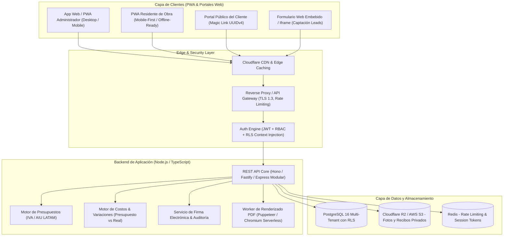

# Especificación Técnica de Arquitectura y Desarrollo (Technical Spec v2.0)
## Plataforma SaaS Integral de Ventas, Presupuestos y Gestión de Obra (MVP)
**Fecha:** Noviembre 2026  
**Documento:** Technical Architecture & System Requirements Specification (SRS)  
**Estado:** Aprobado para Construcción y Desarrollo  

---

## 1. Arquitectura General del Sistema y Stack Tecnológico

### 1.1 Diagrama de Topología del Sistema
El sistema se diseña bajo un patrón de **Monolito Modular Cloud-Native** con arquitectura desacoplada para clientes públicos y clientes autenticados.



### 1.2 Definición del Stack Tecnológico Recomendado

| Componente | Tecnología Seleccionada | Justificación Técnica |
| :--- | :--- | :--- |
| **Frontend Framework** | **React 19 + Vite (TypeScript)** o **Next.js (App Router)** | Renderizado reactivo rápido, ecosistema robusto para PWA y manejo estricto de tipos. |
| **PWA & Offline** | **Workbox + Service Workers + IndexedDB (idb-keyval)** | Permite registrar gastos y avances de bitácora sin conectividad en obras remotas y sincronizar en background. |
| **Estilos & UI** | **Tailwind CSS + shadcn/ui + Lucide Icons** | Componentes accesibles, ligeros, consistentes y optimizados para interfaces móviles densas. |
| **Compresión Multimedia** | **browser-image-compression (Canvas API)** | Compresión obligatoria en el cliente para mantener imágenes por debajo de 800 KB antes de cualquier subida HTTP. |
| **Firma Digital** | **Signature Pad (HTML5 Canvas + Bezier Curves)** | Captura de vector de trazo con exportación PNG/SVG y cálculo de hash criptográfico de integridad. |
| **Backend Runtime** | **Node.js (LTS v22) con TypeScript / Fastify o Hono** | Latencia ultra baja ($<300$ ms), alto rendimiento I/O y tipado end-to-end compartido con el frontend. |
| **Base de Datos** | **PostgreSQL 16 con Row Level Security (RLS)** | Aislamiento estricto multi-tenant a nivel de base de datos, consultas relacionales transaccionales y soporte JSONB. |
| **Object Storage** | **Cloudflare R2 / AWS S3 (Bucket Privado con Signed URLs)** | Almacenamiento económico y seguro; sin costos de egreso de datos (R2), con URLs prefirmadas de subida y lectura efímera (15 min). |
| **Generación de PDFs** | **@react-pdf/renderer** o **Chromium Serverless (Puppeteer-core)** | Generación determinista y de alta fidelidad para propuestas comerciales, órdenes de cambio y estados de cuenta. |

---

## 2. Seguridad, Modelo Multi-Tenant y RBAC

### 2.1 Aislamiento Multi-Tenant (Row-Level Security)
El aislamiento de datos es lógico y no negociable. Cada tabla del dominio pertenece a una organización mediante la columna `organization_id UUID NOT NULL`.

```sql
-- Contexto de sesión inyectado al validar el JWT
SET LOCAL app.current_organization_id = 'e3b0c442-98fc-1c14-9af3-4c76b92f44e1';
SET LOCAL app.current_user_id = '7c9e6679-7425-40de-944b-e07fc1f90ae7';
SET LOCAL app.current_user_role = 'resident'; -- 'owner' | 'resident'
```

### 2.2 Matriz de Control de Acceso Basado en Roles (RBAC)

| Módulo / Recurso | Admin / Dueño (`owner`) | Residente de Obra (`resident`) | Cliente Final (Magic Link UUID) |
| :--- | :---: | :---: | :---: |
| **CRM: Leads y Oportunidades** | CRUD Total + Métricas | **Acceso Denegado (403)** | **Acceso Denegado (403)** |
| **Visita Técnica y Levantamiento** | CRUD Total | Lectura/Escritura notas técnicas | **Acceso Denegado (403)** |
| **Catálogo Maestro de Costos** | CRUD Total (Costos Internos) | **Acceso Denegado (403)** | **Acceso Denegado (403)** |
| **Presupuesto: Costos Unitarios Internos** | Lectura y Edición | **Oculto / Enmascarado (`NULL`)** | **Oculto / Enmascarado (`NULL`)** |
| **Presupuesto: Márgenes de Utilidad** | Configuración Total | **Oculto / Enmascarado (`NULL`)** | **Oculto / Enmascarado (`NULL`)** |
| **Presupuesto: Cantidades y Alcance Técnico** | Lectura y Edición | Solo Lectura (Planificación de campo) | Solo Lectura (En propuesta comercial) |
| **Propuesta Comercial y Firma** | Crear, Enviar, Anular | Sin acceso comercial | Visualizar y Firmar Digitalmente |
| **Control de Costos: Gastos de Obra** | Registrar, Aprobar, Auditar | Registrar compras con foto factura | **Acceso Denegado (403)** |
| **Órdenes de Cambio (Adicionales)** | Crear, Cotizar, Enviar | Solicitar borrador de adicional | Visualizar y Firmar Digitalmente |
| **Cronograma de Tareas** | CRUD Total | Actualizar estado (Pendiente/Hecho) | Solo Lectura (Hitos macro opcionales) |
| **Bitácora Diaria (Fotos y Notas)** | CRUD Total + Filtro Cliente | Crear entradas + Subir fotos | Solo visualiza entradas marcadas `visible=true` |
| **Cobros y Estado de Cuenta** | Registrar cobros, ver márgenes | **Acceso Denegado (403)** | Visualizar saldo pendiente y PDF |

---

## 3. Modelo de Datos Entidad-Relación y DDL PostgreSQL

### 3.1 Script DDL en PostgreSQL

```sql
-- Habilitar extensión UUID
CREATE EXTENSION IF NOT EXISTS "uuid-ossp";

-- 1. ORGANIZACIONES (TENANTS)
CREATE TABLE organizations (
    id UUID PRIMARY KEY DEFAULT uuid_generate_v4(),
    name VARCHAR(255) NOT NULL,
    tax_id VARCHAR(50), -- NIT / RFC / CIF
    phone VARCHAR(50),
    email VARCHAR(150),
    currency VARCHAR(10) DEFAULT 'USD',
    tax_scheme VARCHAR(20) DEFAULT 'IVA', -- 'IVA' | 'AIU'
    default_vat_rate NUMERIC(5,2) DEFAULT 19.00,
    created_at TIMESTAMPTZ DEFAULT NOW(),
    updated_at TIMESTAMPTZ DEFAULT NOW()
);

-- 2. USUARIOS Y MEMBRESÍA
CREATE TABLE users (
    id UUID PRIMARY KEY DEFAULT uuid_generate_v4(),
    organization_id UUID NOT NULL REFERENCES organizations(id) ON DELETE CASCADE,
    email VARCHAR(150) NOT NULL UNIQUE,
    password_hash VARCHAR(255) NOT NULL,
    full_name VARCHAR(150) NOT NULL,
    phone VARCHAR(50),
    role VARCHAR(20) NOT NULL CHECK (role IN ('owner', 'resident')),
    is_active BOOLEAN DEFAULT TRUE,
    created_at TIMESTAMPTZ DEFAULT NOW(),
    updated_at TIMESTAMPTZ DEFAULT NOW()
);
CREATE INDEX idx_users_org ON users(organization_id);

-- 3. CRM: LEADS Y OPORTUNIDADES
CREATE TABLE leads (
    id UUID PRIMARY KEY DEFAULT uuid_generate_v4(),
    organization_id UUID NOT NULL REFERENCES organizations(id) ON DELETE CASCADE,
    client_name VARCHAR(150) NOT NULL,
    client_phone VARCHAR(50) NOT NULL,
    client_email VARCHAR(150),
    project_address TEXT NOT NULL,
    project_type VARCHAR(100),
    source VARCHAR(50) DEFAULT 'manual', -- 'manual', 'web_form', 'whatsapp'
    stage VARCHAR(30) NOT NULL DEFAULT 'new_lead' 
        CHECK (stage IN ('new_lead', 'visit_scheduled', 'in_budgeting', 'proposal_sent', 'negotiation', 'won', 'lost')),
    lost_reason VARCHAR(100), -- 'Precio', 'Tiempo', 'Sin respuesta', 'Otro'
    estimated_budget NUMERIC(14,2) DEFAULT 0.00,
    created_by UUID REFERENCES users(id),
    created_at TIMESTAMPTZ DEFAULT NOW(),
    updated_at TIMESTAMPTZ DEFAULT NOW()
);
CREATE INDEX idx_leads_org_stage ON leads(organization_id, stage);

-- 4. VISITAS TÉCNICAS Y FOTOS DEL ANTES
CREATE TABLE site_visits (
    id UUID PRIMARY KEY DEFAULT uuid_generate_v4(),
    organization_id UUID NOT NULL REFERENCES organizations(id) ON DELETE CASCADE,
    lead_id UUID NOT NULL REFERENCES leads(id) ON DELETE CASCADE,
    scheduled_for TIMESTAMPTZ NOT NULL,
    conducted_at TIMESTAMPTZ,
    technical_notes TEXT,
    completed BOOLEAN DEFAULT FALSE,
    created_at TIMESTAMPTZ DEFAULT NOW()
);

CREATE TABLE visit_attachments (
    id UUID PRIMARY KEY DEFAULT uuid_generate_v4(),
    site_visit_id UUID NOT NULL REFERENCES site_visits(id) ON DELETE CASCADE,
    file_url TEXT NOT NULL,
    file_name VARCHAR(255),
    file_size_kb INT,
    created_at TIMESTAMPTZ DEFAULT NOW()
);

-- 5. CATÁLOGO MAESTRO DE COSTOS
CREATE TABLE catalog_items (
    id UUID PRIMARY KEY DEFAULT uuid_generate_v4(),
    organization_id UUID NOT NULL REFERENCES organizations(id) ON DELETE CASCADE,
    code VARCHAR(50),
    name VARCHAR(255) NOT NULL,
    description TEXT,
    category VARCHAR(50) NOT NULL CHECK (category IN ('material', 'labor', 'subcontract', 'equipment')),
    unit VARCHAR(30) NOT NULL, -- 'm2', 'ml', 'und', 'glb', 'dia'
    base_unit_cost NUMERIC(14,2) NOT NULL DEFAULT 0.00,
    created_at TIMESTAMPTZ DEFAULT NOW(),
    updated_at TIMESTAMPTZ DEFAULT NOW()
);
CREATE INDEX idx_catalog_org ON catalog_items(organization_id);

-- 6. PRESUPUESTOS (BUDGETS)
CREATE TABLE budgets (
    id UUID PRIMARY KEY DEFAULT uuid_generate_v4(),
    organization_id UUID NOT NULL REFERENCES organizations(id) ON DELETE CASCADE,
    lead_id UUID REFERENCES leads(id) ON DELETE SET NULL,
    version INT DEFAULT 1,
    title VARCHAR(255) NOT NULL,
    status VARCHAR(30) DEFAULT 'draft' CHECK (status IN ('draft', 'sent', 'approved', 'rejected', 'frozen')),
    tax_scheme VARCHAR(20) DEFAULT 'IVA' CHECK (tax_scheme IN ('IVA', 'AIU')),
    
    global_margin_percentage NUMERIC(5,2) DEFAULT 25.00,
    vat_percentage NUMERIC(5,2) DEFAULT 19.00,

    admin_percentage NUMERIC(5,2) DEFAULT 10.00,
    contingency_percentage NUMERIC(5,2) DEFAULT 5.00,
    utility_percentage NUMERIC(5,2) DEFAULT 5.00,

    total_direct_cost NUMERIC(14,2) DEFAULT 0.00,
    total_sale_price NUMERIC(14,2) DEFAULT 0.00,
    total_tax NUMERIC(14,2) DEFAULT 0.00,
    grand_total NUMERIC(14,2) DEFAULT 0.00,

    created_at TIMESTAMPTZ DEFAULT NOW(),
    updated_at TIMESTAMPTZ DEFAULT NOW()
);

-- 7. CAPÍTULOS Y PARTIDAS DE PRESUPUESTO
CREATE TABLE budget_chapters (
    id UUID PRIMARY KEY DEFAULT uuid_generate_v4(),
    budget_id UUID NOT NULL REFERENCES budgets(id) ON DELETE CASCADE,
    order_index INT NOT NULL DEFAULT 0,
    name VARCHAR(255) NOT NULL,
    created_at TIMESTAMPTZ DEFAULT NOW()
);

CREATE TABLE budget_items (
    id UUID PRIMARY KEY DEFAULT uuid_generate_v4(),
    chapter_id UUID NOT NULL REFERENCES budget_chapters(id) ON DELETE CASCADE,
    catalog_item_id UUID REFERENCES catalog_items(id) ON DELETE SET NULL,
    order_index INT NOT NULL DEFAULT 0,
    description TEXT NOT NULL,
    category VARCHAR(50) NOT NULL,
    unit VARCHAR(30) NOT NULL,
    quantity NUMERIC(12,4) NOT NULL DEFAULT 1.0000,
    unit_cost_internal NUMERIC(14,2) NOT NULL DEFAULT 0.00,
    margin_percentage NUMERIC(5,2) NOT NULL DEFAULT 25.00,
    unit_sale_price NUMERIC(14,2) NOT NULL DEFAULT 0.00,
    subtotal_direct_cost NUMERIC(14,2) GENERATED ALWAYS AS (quantity * unit_cost_internal) STORED,
    subtotal_sale_price NUMERIC(14,2) GENERATED ALWAYS AS (quantity * unit_sale_price) STORED
);

-- 8. PROPUESTAS COMERCIALES, SEGUIMIENTO Y FIRMA
CREATE TABLE proposals (
    id UUID PRIMARY KEY DEFAULT uuid_generate_v4(),
    organization_id UUID NOT NULL REFERENCES organizations(id) ON DELETE CASCADE,
    budget_id UUID NOT NULL REFERENCES budgets(id) ON DELETE CASCADE,
    public_token UUID NOT NULL DEFAULT uuid_generate_v4() UNIQUE,
    status VARCHAR(30) DEFAULT 'draft' CHECK (status IN ('draft', 'sent', 'opened', 'signed', 'expired')),
    expires_at TIMESTAMPTZ,
    created_at TIMESTAMPTZ DEFAULT NOW(),
    updated_at TIMESTAMPTZ DEFAULT NOW()
);
CREATE INDEX idx_proposals_token ON proposals(public_token);

CREATE TABLE proposal_views (
    id UUID PRIMARY KEY DEFAULT uuid_generate_v4(),
    proposal_id UUID NOT NULL REFERENCES proposals(id) ON DELETE CASCADE,
    viewed_at TIMESTAMPTZ DEFAULT NOW(),
    ip_address VARCHAR(45),
    user_agent TEXT
);

CREATE TABLE proposal_signatures (
    id UUID PRIMARY KEY DEFAULT uuid_generate_v4(),
    proposal_id UUID NOT NULL UNIQUE REFERENCES proposals(id) ON DELETE CASCADE,
    signer_name VARCHAR(150) NOT NULL,
    signature_data_url TEXT NOT NULL,
    integrity_hash VARCHAR(64) NOT NULL,
    ip_address VARCHAR(45) NOT NULL,
    user_agent TEXT NOT NULL,
    signed_at TIMESTAMPTZ DEFAULT NOW()
);

-- 9. PROYECTOS (OBRAS ACTIVAS TRAS CIERRE)
CREATE TABLE projects (
    id UUID PRIMARY KEY DEFAULT uuid_generate_v4(),
    organization_id UUID NOT NULL REFERENCES organizations(id) ON DELETE CASCADE,
    lead_id UUID REFERENCES leads(id),
    base_budget_id UUID NOT NULL REFERENCES budgets(id),
    name VARCHAR(255) NOT NULL,
    client_name VARCHAR(150) NOT NULL,
    client_phone VARCHAR(50),
    client_email VARCHAR(150),
    address TEXT NOT NULL,
    public_portal_token UUID NOT NULL DEFAULT uuid_generate_v4() UNIQUE,
    status VARCHAR(30) DEFAULT 'in_progress' CHECK (status IN ('planning', 'in_progress', 'completed', 'canceled')),
    start_date DATE,
    end_date DATE,
    created_at TIMESTAMPTZ DEFAULT NOW(),
    updated_at TIMESTAMPTZ DEFAULT NOW()
);
CREATE INDEX idx_projects_portal_token ON projects(public_portal_token);

-- 10. ÓRDENES DE CAMBIO (CHANGE ORDERS)
CREATE TABLE change_orders (
    id UUID PRIMARY KEY DEFAULT uuid_generate_v4(),
    project_id UUID NOT NULL REFERENCES projects(id) ON DELETE CASCADE,
    order_number INT NOT NULL,
    title VARCHAR(255) NOT NULL,
    description TEXT,
    public_sign_token UUID NOT NULL DEFAULT uuid_generate_v4() UNIQUE,
    status VARCHAR(30) DEFAULT 'pending' CHECK (status IN ('draft', 'pending_signature', 'approved', 'rejected')),
    total_direct_cost NUMERIC(14,2) DEFAULT 0.00,
    total_sale_price NUMERIC(14,2) DEFAULT 0.00,
    signed_at TIMESTAMPTZ,
    signature_data_url TEXT,
    signature_ip VARCHAR(45),
    created_at TIMESTAMPTZ DEFAULT NOW(),
    updated_at TIMESTAMPTZ DEFAULT NOW()
);

CREATE TABLE change_order_items (
    id UUID PRIMARY KEY DEFAULT uuid_generate_v4(),
    change_order_id UUID NOT NULL REFERENCES change_orders(id) ON DELETE CASCADE,
    budget_chapter_id UUID REFERENCES budget_chapters(id),
    description TEXT NOT NULL,
    unit VARCHAR(30) NOT NULL,
    quantity NUMERIC(12,4) NOT NULL DEFAULT 1.0000,
    unit_cost_internal NUMERIC(14,2) NOT NULL DEFAULT 0.00,
    unit_sale_price NUMERIC(14,2) NOT NULL DEFAULT 0.00
);

-- 11. REGISTRO DE GASTOS Y COSTEO REAL (JOB COSTING)
CREATE TABLE expenses (
    id UUID PRIMARY KEY DEFAULT uuid_generate_v4(),
    organization_id UUID NOT NULL REFERENCES organizations(id) ON DELETE CASCADE,
    project_id UUID NOT NULL REFERENCES projects(id) ON DELETE CASCADE,
    budget_chapter_id UUID REFERENCES budget_chapters(id) ON DELETE SET NULL,
    budget_item_id UUID REFERENCES budget_items(id) ON DELETE SET NULL,
    supplier_name VARCHAR(150),
    invoice_number VARCHAR(100),
    amount NUMERIC(14,2) NOT NULL,
    expense_date DATE NOT NULL DEFAULT CURRENT_DATE,
    receipt_file_url TEXT,
    notes TEXT,
    created_by UUID REFERENCES users(id),
    created_at TIMESTAMPTZ DEFAULT NOW()
);
CREATE INDEX idx_expenses_project_chapter ON expenses(project_id, budget_chapter_id);

-- 12. CRONOGRAMA LIGERO (TASKS)
CREATE TABLE tasks (
    id UUID PRIMARY KEY DEFAULT uuid_generate_v4(),
    project_id UUID NOT NULL REFERENCES projects(id) ON DELETE CASCADE,
    budget_chapter_id UUID REFERENCES budget_chapters(id) ON DELETE SET NULL,
    title VARCHAR(255) NOT NULL,
    assigned_to UUID REFERENCES users(id),
    start_date DATE NOT NULL,
    end_date DATE NOT NULL,
    status VARCHAR(30) DEFAULT 'pending' CHECK (status IN ('pending', 'in_progress', 'completed')),
    created_at TIMESTAMPTZ DEFAULT NOW(),
    updated_at TIMESTAMPTZ DEFAULT NOW()
);

-- 13. BITÁCORA DIARIA (DAILY LOGS)
CREATE TABLE daily_logs (
    id UUID PRIMARY KEY DEFAULT uuid_generate_v4(),
    project_id UUID NOT NULL REFERENCES projects(id) ON DELETE CASCADE,
    log_date DATE NOT NULL DEFAULT CURRENT_DATE,
    weather VARCHAR(50),
    notes TEXT NOT NULL,
    visible_to_client BOOLEAN DEFAULT TRUE,
    created_by UUID REFERENCES users(id),
    created_at TIMESTAMPTZ DEFAULT NOW()
);
CREATE INDEX idx_daily_logs_project_date ON daily_logs(project_id, log_date);

CREATE TABLE daily_log_photos (
    id UUID PRIMARY KEY DEFAULT uuid_generate_v4(),
    daily_log_id UUID NOT NULL REFERENCES daily_logs(id) ON DELETE CASCADE,
    photo_url TEXT NOT NULL,
    thumbnail_url TEXT,
    caption VARCHAR(255),
    created_at TIMESTAMPTZ DEFAULT NOW()
);

-- 14. GESTIÓN DE ANTICIPOS Y PAGOS DEL CLIENTE
CREATE TABLE client_payments (
    id UUID PRIMARY KEY DEFAULT uuid_generate_v4(),
    organization_id UUID NOT NULL REFERENCES organizations(id) ON DELETE CASCADE,
    project_id UUID NOT NULL REFERENCES projects(id) ON DELETE CASCADE,
    payment_date DATE NOT NULL DEFAULT CURRENT_DATE,
    amount NUMERIC(14,2) NOT NULL,
    payment_method VARCHAR(50) NOT NULL CHECK (payment_method IN ('transfer', 'cash', 'card', 'check', 'other')),
    reference_number VARCHAR(100),
    receipt_file_url TEXT,
    notes TEXT,
    registered_by UUID REFERENCES users(id),
    created_at TIMESTAMPTZ DEFAULT NOW()
);
CREATE INDEX idx_client_payments_project ON client_payments(project_id);
```

---

## 4. Lógica de Negocio y Fórmulas Matemáticas

### 4.1 Motor de Presupuestación y Liquidación Impositiva
1. **Costo Directo por Línea ($CD_i$):**
   $$CD_i = \text{quantity}_i \times \text{unit\_cost\_internal}_i$$

2. **Precio Venta Línea ($PV_i$):**
   $$PV_i = CD_i \times \left(1 + \frac{\text{margin\_percentage}_i}{100}\right)$$

3. **Esquema Estándar (IVA):**
   $$\text{Subtotal Venta} = \sum PV_i$$
   $$\text{IVA} = \text{Subtotal Venta} \times \frac{\text{vat\_percentage}}{100}$$
   $$\text{Total} = \text{Subtotal Venta} + \text{IVA}$$

4. **Esquema AIU (Latinoamérica):**
   $$\text{CDT} = \sum CD_i$$
   $$\text{Administración} = \text{CDT} \times A\%, \quad \text{Imprevistos} = \text{CDT} \times I\%, \quad \text{Utilidad} = \text{CDT} \times U\%$$
   $$\text{IVA}_{\text{Utilidad}} = \text{Utilidad} \times \text{IVA}\%$$
   $$\text{Total Contrato} = \text{CDT} + \text{Administración} + \text{Imprevistos} + \text{Utilidad} + \text{IVA}_{\text{Utilidad}}$$

---

### 4.2 Matriz de Costos y Variaciones (Job Costing Variance)
- **Presupuesto Vigente:** $\text{Presupuesto Base} + \text{Órdenes de Cambio Aprobadas}$
- **Saldo Disponible:** $\text{Presupuesto Vigente} - \text{Costo Real Ejecutado}$
- **Alerta de Semáforo:**
  - 🟢 **Verde:** $\% \text{ Consumo} \le 85\%$
  - 🟡 **Amarillo:** $85\% < \% \text{ Consumo} \le 100\%$
  - 🔴 **Rojo:** $\% \text{ Consumo} > 100\%$

---

## 5. Especificación de Endpoints REST Clave

| Método | Endpoint | Roles Permitidos | Propósito |
| :--- | :--- | :--- | :--- |
| `POST` | `/api/v1/leads/quick` | `owner` | Captura rápida de lead comercial ($<15$s) |
| `POST` | `/api/v1/public/leads` | Público / Iframe | Captura de lead desde web externa |
| `GET` | `/api/v1/leads/kanban` | `owner` | Retorna columnas con sumatoria monetaria |
| `POST` | `/api/v1/budgets/:id/calculate` | `owner` | Recalcula totales IVA / AIU |
| `GET` | `/api/v1/public/p/:token` | Público (Cliente) | Propuesta para el cliente (sin costos internos) |
| `POST` | `/api/v1/public/p/:token/sign` | Público (Cliente) | Firma digital, congela presupuesto y crea proyecto |
| `GET` | `/api/v1/projects/:id/cost-matrix` | `owner` | Matriz Presupuesto vs Real por capítulo |
| `POST` | `/api/v1/projects/:id/expenses` | `owner`, `resident` | Registro rápido de facturas con foto |
| `POST` | `/api/v1/projects/:id/change-orders` | `owner` | Creación de adición con enlace de firma |
| `POST` | `/api/v1/projects/:id/daily-logs` | `owner`, `resident` | Publica bitácora con fotos optimizadas |
| `GET` | `/api/v1/public/portal/:token/summary`| Público (Cliente) | Dashboard financiero y fotos aprobadas |
| `POST` | `/api/v1/storage/upload-url` | `owner`, `resident` | Genera URL pre-firmada para subida a R2/S3 |

---

## 6. Pipeline de Compresión Móvil (PWA)
1. Usuario toma foto con cámara móvil (resolución 12–48 MP, tamaño 5–12 MB).
2. Canvas API en navegador redimensiona la imagen a máximo $1920 \times 1080$ px.
3. Se comprime con formato WebP a calidad 0.8 logrando tamaño objetivo $< 800\text{ KB}$.
4. Se solicita pre-signed URL al backend y se sube el binario directamente al Object Storage (Cloudflare R2).

---

## 7. Plan de Sprints (8 Semanas / 4 Sprints)
- **Sprint 1 (Semanas 1–2):** Arquitectura Multi-tenant RLS, Autenticación JWT RBAC, Captura Rápida de Leads, Formulario Web Público y Tablero Kanban Comercial.
- **Sprint 2 (Semanas 3–4):** Catálogo Maestro de Costos, Constructor Jerárquico de Presupuestos, Motor de Cálculo IVA / AIU y Duplicación de Plantillas.
- **Sprint 3 (Semanas 5–6):** Propuestas Comerciales Web, Tracking de Apertura, Firma Digital con Hash de Integridad, Congelamiento de Presupuesto Base y Matriz de Costeo Real (Job Costing).
- **Sprint 4 (Semanas 7–8):** Órdenes de Cambio con Firma, Cronograma Ligero, Bitácora Diaria con Compresión Móvil, Portal del Cliente Unificado, Control de Cobros y QA Integral.
